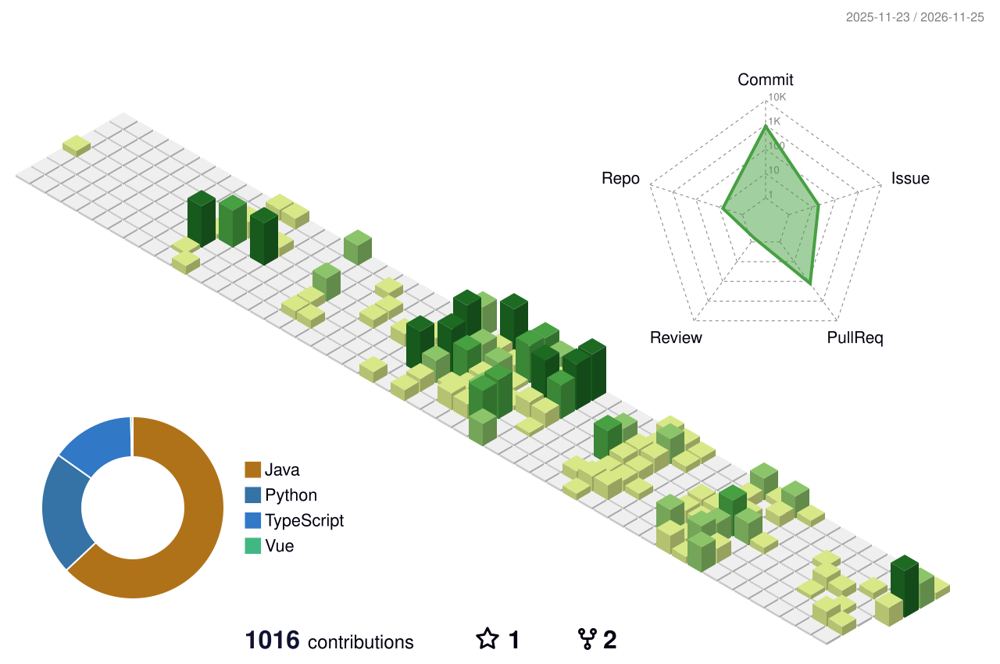

 

## 🛠 Tech Stack

| | |
| :-- | :-- |
| **Language** |  |
| **Backend** |   |
| **Data** |    |
| **Infra** |    |
| **Tools** |      |

 

## 🚀 Projects

| Project | Description | Stack |
| :-- | :-- | :-- |
| 🌏 **[What In the World](https://github.com/minseok0602/witw)** | 47개국 1,225개 언론사 기사를 이슈로 묶고, 나라별 논조를 3D 지구본 위에서 비교하는 서비스 | `Spring Boot` `Kafka` `Spark` `React` |
| 🎤 **[싸스케 · SSAFY STAR K](https://github.com/minseok0602/ssasukae)** | 최대 4명이 함께 부르고 카드로 겨루는 실시간 화상 노래방, AI 가창 피드백까지 | `Spring Boot` `Next.js` `WebRTC` `Redis` |
| ⚡ **[OpenKache](https://github.com/minseok0602/OpenKache)** | 고성능 분산 캐시의 가용성·확장성 알고리즘을 공통 서버 위에 구현하고 비교하는 연구 프로젝트 | `Java 21` `Netty` `Prometheus` `Grafana` |

 

## 📊 GitHub Stats

  

<picture>
  <source media="(prefers-color-scheme: dark)" srcset="./profile-3d-contrib/profile-night-moon.svg" />
  
</picture>

